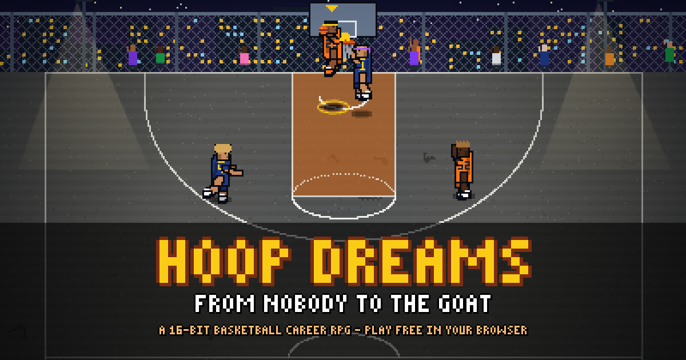

# 🏀 Hoop Dreams — 16-Bit Basketball Career RPG

**▶ [Play now](https://aquoric.github.io/hoop-dreams/)** — free, in your browser, on desktop or phone. No download, no account.



Start as an unknown 16-year-old on a cracked playground court and try to become the GOAT. Make story choices, play key moments with quick minigames, and take over in real-time 16-bit arcade play on fast breaks, loose balls and final possessions. Build your player, earn badges, get recruited, and see where your career ends up.

> All teams, players, leagues and schools in this game are **fictional parodies**. Any resemblance to real people or teams is for fun only. No real logos or likenesses are used.

## Controls

| | Desktop | Phone / tablet |
|---|---|---|
| **Story** | Click or <kbd>Space</kbd> to advance · choices: click or <kbd>1</kbd>–<kbd>5</kbd> | Tap to advance · tap a choice |
| **Decisions in games** | Click an option or press <kbd>1</kbd>–<kbd>4</kbd> · hover to see what affects the % | Tap an option · long-press to see what affects the % |
| **Minigames** | <kbd>Space</kbd> / click to time it · arrows or <kbd>WASD</kbd> for dribble combos and defense | Tap to time it · swipe or tap the on-screen arrows |
| **Arcade play** | Move <kbd>WASD</kbd> / arrows · shoot or block <kbd>J</kbd> / <kbd>Space</kbd> (hold, release at the top of the jump) · pass or steal <kbd>K</kbd> · dribble move <kbd>L</kbd> / <kbd>Shift</kbd> · loose balls: run to the yellow ◎ and press <kbd>J</kbd> / <kbd>Space</kbd> to dive | Joystick (left) · **SHOOT**, **PASS**, **MOVE** and **⚔ WEAPON** buttons (right). Turning your phone sideways gives a bigger court. |

## Your saves

The game autosaves after every step. **Saves live in your browser on that device**, so a career on your phone won't appear on your laptop (and clearing your browser data deletes it). To move a career to another device or share it with a friend, open **⚙ Settings → Export save file**, send the file, and on the other device use **Load → Import**.

## Run it yourself

Download the code and double-click **`index.html`**. There's no install, no build step and no server needed. Every graphic is drawn in code, so it works offline too (fonts fall back to system fonts).

## How to play

| Where | What you do |
|---|---|
| **Story** | Click or press <kbd>Space</kbd> to advance. Pick choices with the mouse or <kbd>1</kbd>–<kbd>5</kbd>. Choices tagged with a stat and % are **stat checks**: they can succeed or fail. Some choices can end your career. |
| **Games** | Each game is 8–15 key **moments** on an animated court. In most moments you **get the ball and choose what to do** (catch & shoot, pull-up, drive, post up, pass, or your Weapon), then **play that option's minigame**. On defense you choose an approach (press, stay back, go for the steal, help & block, contest), then play it. A few quick decision-only moments keep the pace up. Every option shows a live success % (green/yellow/red). **Hover or long-press** an option to see what's affecting it. |
| **Arcade segments** | Every game is played with choices and minigames, and switches into real-time 16-bit arcade play for single possessions **at least 3 times** (3–5 in a full match, 3–4 in a pickup game), spread across the game. Each trigger has its own banner: **FAST BREAK!** (after a steal, block or defensive rebound), **LOOSE BALL!** (both teams dive for it — whoever wins it plays the possession), **SCRAMBLE!** (put-back battle off a miss), **BROKEN PLAY!** (shot clock running out), **BEAT THE BUZZER!** (last possession of a quarter/half) and **FINAL POSSESSION!** (the last possession of a close game). Each segment ends on a score, miss, turnover, foul or defense set, and the score, box score, fatigue and play-by-play update. Pickups (hub Pickup Run, story playground games, the Kai 1-on-1) keep their small-sided format (3v3 or 1v1, first to the target). Controls: WASD/arrows move · **J/SPACE** shoot (hold, release at the top of the jump) or block · **K** pass/steal · **L/SHIFT** dribble move (on defense: slide; slide + K = shove). Touch: joystick + SHOOT / PASS / MOVE. |
| **Courts** | 61 courts in the same 16-bit style, each with its own look, crowd, lighting and ambient sound: six street courts (night, day park, the cage, rooftop, beach at sunset, rainy night with puddle reflections), a gym for every high school, a community center, an AAU showcase hall, a college fieldhouse, a tournament dome, a home arena for all 30 NBL teams (team colors + logo at center court), the draft combine, summer league, All-Star weekend, the Finals, eight overseas arenas (Madrid, Istanbul, Athens, Belgrade, Paris, Tokyo, Sydney, Beijing) with local chants, and a practice facility for training. The game picks the venue from the story, opponent and home/away. Courts you play on unlock in the hub's **Courts** tab, where you choose the court for pickup runs. |
| **Cutscenes** | Short 16-bit anime-style episodes (8–20 seconds) at key moments: the opening, the rival, getting scouted, making varsity, game-winners in big games, the state title, injuries and career-ending paths. Camera cuts, animated portraits that blink and talk, typewriter dialogue with character voices, speed lines, impact frames and freeze frames. They play through without skipping. |
| **Weapons for everyone** | Like Blue Lock, every key player has 1–2 **weapons** (signature skills): teammates, rivals, Kai Sterling, every team's star (a logo three, a step-back, a spin fadeaway, a poster dunk, a no-look dime, a lockdown stance, a chase-down block, a sky hook…). Yours start with the one you rolled; **new weapon slots open at levels 5, 11 and 18**, and every weapon has **5 ranks** you buy with Skill Points (Upgrade tab). A weapon's % uses only its own stats, grows with your level and rank, and is never automatic. Using one gives a name pop-up, a freeze frame and an aura. When a star uses his weapon on you, you get a **counter moment**: pick how to defend (each option shows your stop chance), then a quick defense minigame. |
| **Everyone plays** | Teammates and opponents get their own visible possessions with their own stats and weapons — you choose how to help (screen, spot up, crash the glass) or whether to help off your man on defense. Stars **take over** after a couple of buckets, and the coach asks if you can guard them. The play-by-play names everyone, and a **live box score** (BOX SCORE tab) plus the post-game screen show both full teams. |
| **Passing** | Kick-outs, lobs to the big, alley-oops, give-and-gos, hockey assists, skip passes and outlets that start fast breaks. You pick the teammate — each option shows his % from his stats, how open he is and his weapon — then thread the pass; a good pass raises his chance. Assists build chemistry and Coach Trust. In arcade play, open teammates show an **OPEN** tag and call for the ball. |
| **Close calls** | A few per close game, more late: the ball rolling around the rim in slow motion, block-or-dunk collisions, charge-or-block calls (set your feet in time), diving to save the ball, buzzer beaters with an instant replay (sometimes just too late), clutch free throws and the game-sealing stop. Slow motion, zoom and a crowd that builds, then a quick reaction minigame decides it with the related stats. |
| **Mini cutscenes** | 2–3 second anime cuts during games for big moments: poster dunks, ankle-breakers, chase-down blocks, weapon activations, and-ones, deep threes, buzzer beaters, momentum runs, timeout huddles and face-offs. Tap to skip. Only a few per game. |
| **Green releases** | A perfect release that goes in — jump shot, layup, dunk or free throw — gets its own **GREEN** sound and flash as the ball drops. A perfect release that still misses is just a miss. Layups use a **1-2 step** indicator: two footprints light up on the beat, then release on the gather when the ring meets the circle at the rim (window from Finishing, smaller when contested). |
| **Talk** | Quick conversations at dead balls with a gauge: the coach (PATIENCE — a play call, more minutes, or the bench), the referee (PATIENCE — the next close call, or a technical) and rival stars (EGO — rattle them, or lose your confidence). Every character has a personality, so the right answer depends on who you're talking to. |
| **Highlights** | Big plays hit harder: a short freeze on dunks, blocks and ankle-breakers, camera shake and zoom, slow motion on game-winners, sparks, dust, sweat and confetti, and a quick close-up cut for your best moments. Players celebrate, teammates run in for chest bumps, and the crowd stands up. |
| **Minigames** | **Shot Meter**: tap at the green. **Free Throws**: tap when the reticle is centered. **Dribble Combo**: arrows/WASD/swipe. **Dunk Timing**: tap when the rings meet. **Lock-In D**: mirror the move (◀ ▲ ▶). **Box Out**: tap in the zone. **Passing Lane**: tap the open teammate (or 1–4). |
| **Streaks** | 3 successes in a row = **ON FIRE** (bonus %, flames). Successes charge your **Weapons**. Close games end in **Clutch Time**. |
| **Hub** | Between story beats: **Train** (minigame drills raise attributes), **Rest**, spend **Skill Points** in Upgrade (radar chart + height-based caps), check **Badges**, buy gear in the **Shop** (shows on your avatar), read your **Social** feed, view **Career** stats and **Achievements**. |
| **Seasons** | In high school you play full seasons. **🔑 Key games** must be played as full matches; any other game can be played or **simmed** for a short summary. The Season tab shows standings, your schedule and a live **playoff bracket**. |
| **Recruiting** | From Chapter 2 you have a **star rating** (1–5★) and national rank that move with your Overall, reputation, scoring and big moments. Colleges send offers once you reach their level (Recruiting tab). |
| **Saves** | Autosaves after every step. ⚙ Settings → 3 manual slots, **Export/Import** a save file, audio volumes, text speed, restart career. Saves are stored in the browser on each device. |

## What's in this build

- **Character creation**: name, hometown, number, difficulty (Pro — the default — or Hall of Fame), position (PG–C), height, wingspan, and a full avatar builder with a live trading-card preview.
  - **Wingspan** is chosen relative to height (3" shorter to 8" longer). Long arms help defense, rebounding, blocks, steals and finishing; very long arms make handles and pure shooting a bit harder.
  - **Rolls**: your **Archetype** and your **Weapon** are rolled separately, with rarity odds Common 42% · Rare 30% · Epic 17% · Legendary 8% · Mythic 3%. You get 5 / 3 rolls for each (Pro / Hall of Fame) and keep the last one you land.
  - **13 archetypes**, inspired by Kuroko no Basket techniques (e.g. Phantom Sixth Man, Full-Court Sniper, Perfect Mirror, Formless Ace, The Emperor). Each has stat bonuses plus a **passive** that changes games, such as Misdirection (+12% on everything early), Perfect Copy (stacking bonus from defensive stops), Right of Postponement (a second chance on failed post moves) or Emperor Eye (longer timing windows and more ankle breaks).
  - **16 rollable weapons**, e.g. Ignite Pass, Vanishing Drive, Phantom Shot, Meteor Jam, Thor's Hammer, Formless Shot, and The Zone (+12% on everything for the rest of the game), plus **14 more you can learn** as you level up (Logo Three, Step-Back Three, Spin Fadeaway, Poster Dunk, No-Look Dime, Lockdown Stance, Chase-Down Block, Sky Hook, Dream Shake…). Each has its own animation, the stats it uses and a charge cost.
- **Stats and progression**: 16 attributes, position-weighted Overall, XP and levels, skill points, 16 badges with Bronze/Silver/Gold/Hall of Fame tiers, hidden meta stats (reputation, fans, confidence, fatigue, chemistry, money, relationships), and 20 achievements.
- **Match engine**: a 16-bit court (shared with arcade play) with animated players, ball arcs, swish/rim/dunk animations, screen shake, slow-motion zooms, flames, confetti, a retro scorebug, live box score, play-by-play, and 8 minigames.
- **Chapter 1: Concrete Dreams (the playground)**: meet mentor **Lou Banks**, rival **Kai Sterling**, best friend **Tariq**, your mom and your sister **Nia**. Three games, the Halsey Summer Jam, a scout, a party that can go very wrong, and the choice between Westbrook Academy and Lincoln High.
- **Chapter 2: Varsity Blues (high school)**: 105 story nodes with separate **Lincoln High** and **Westbrook Academy** paths that rejoin for the summer and senior year.
  - **Arc**: tryouts, a coach who doubts you (Brennan or Graves), earning minutes, a locker-room fight, and rivalry games against Kai, with his father Silk in the stands.
  - **Seasons**: junior season with the City Playoffs, the Peach Slam AAU circuit, and senior season with the State Tournament. You play key games and can sim the rest.
  - **Relationships and recruiting**: a viral mixtape, Nia's birthday vs. the Elite 100 Camp, Mom's injury, Tariq failing chemistry, a booster with an envelope, recruiting stars, college offers, and Signing Day.
  - **Where it ends**: you pick a fictional university, or skip college for Europe or the Grind League. That choice sets up Chapter 3.
  - **Early endings**: two new ways to end your career (a "sneaker flip" with Cousin Marcus, and painkillers on a broken foot).
- **Interlude: Red, White & Hoops** (`js/data-usa.js`, `js/usa.js`): the U.S. Youth National Team arc, the summer after high school (or the summer before senior year for top-25 recruits). Invite or open tryout, selection camp at the National Training Center (drills ranked against 16 other campers, a Red-White scrimmage, King of the Court 3v3 against Kai, film sessions and evaluations with Coach Reyes), dorm drama, two cut days on a live "on the bubble" board, then the World Youth Championship in Riga: group stage, knockouts and a final against France's Bastien Mbaye. Medals go to the trophy room, making the team unlocks a national-team jersey, and it all feeds reputation, recruiting, draft stock and overseas interest. Get cut and you get a second chance after graduation.
- **Season system** (`js/season.js`): a reusable schedule, simulated league results, standings, playoff brackets, simulated stat lines, and a coach-trust role (Starter / Sixth Man / Bench). It's built to be reused for college, pro and overseas seasons.
- **Game day**: big games (away trips, rivals, playoffs, story games) open with a skippable pre-game sequence (bus or flight, arriving in the city, walking in past their fans; or the locker room, tunnel walk and intros; or sizing up a pickup run), a face-off with their star and one short pre-game talk. During the game you get at most one conversation, and only after something that matters.
- **Instant replays**: dunks, deep threes, blocks, broken ankles, and-ones and buzzer-beaters replay the actual play from two angles, the second in slow motion.
- **Fullscreen** (⛶ in the match bar, offered at tip-off): the court fills the screen and the scorebug, choices, play-by-play, box score and gauges share one side panel. On portrait phones everything stacks.
- **Layup drives**: read your defender's tell (lean, feet, reach or hips) and attack the other side for a BLOW BY, or get CUT OFF (tough finish, charge or steal). Sometimes you also hit a left-right gather step before the layup release. Windows and odds are in `BALANCE.layup`.
- **Feature unlocks** (`js/data-features.js`, `js/features.js`): each chapter opens something new with a **NEW FEATURE UNLOCKED** cinematic (it waits for a calm screen, never mid-game) and its own hub tab. Old saves get one combined popup for everything they'd already earned. The Career tab lists every feature and when it unlocks.
  - **Court Rep Map** (Chapter 1): six court legends, from Old Man Riggs on Halsey Street to "Monsoon" Marcus Vane in the rain. Beat each one 1-on-1 (arcade, first to 11) for Rep and fans; that opens the next court.
  - **Playbook** (Chapter 2): your coach teaches set plays one at a time (Practice with Coach, 1 action): Pick-and-Roll, Backdoor Cut, Isolation, Post Entry, Flare Screen, Horns. Learned plays become offense options in team games, each with its own % and court animation.
  - **Highlight Mixtape** (Chapter 2): your best plays are saved after every game; release a tape once a season for a recruiting, follower and Rep boost based on how good the clips are.
  - **Chemistry Links** (national team): play with Dre, Jet, Malik, Milo or Kai and build a link. Max it for a duo move (give-and-go, Jet Lob, High-Low, Drive & Kick, Two-Man Game) in matches and arcade play.
  - **Jelly Layups** (national team): Big Ike stuffs you at camp, assistant coach **Scoop DeLuca** teaches you the jelly on court two at night, it drops in the next morning run, and the payoff comes over France's 7-footer in the final (or in your next big game if you're cut; he teaches you in the parking lot before you leave). After you beat your man, pick **JELLY** when help is coming: in slow motion his arm swings up one side, flick to the other side (←/→), then tap as the ring closes on the glass. Arcade: drive at the rim with a defender close, **hold MOVE and shoot**. Kai and a few international stars have it too. Numbers in `BALANCE.jelly`.
  - **Celebrations** (all chapters): unlocked by levels, wins, posters, game-winners and titles; yours plays after big buckets in matches and arcade play.
- **Audio**: music and effects are synthesized with the Web Audio API; the crowd uses real recordings (one venue loop, capped reactions). 🔊 mutes everything.

*Coming in later builds: College/Overseas/G-League routes (Chapter 3), the Draft, the 30-team pro league, overseas leagues, legacy endings.*

**Future-chapter features switch on by themselves.** Their data and hub tabs are already in `js/data-features.js` / `js/features.js`; each one waits on `when: { chapter: '…' }` and unlocks the first time a player reaches that chapter, once it exists in `STORY.chapters` (ids in `CHAPTER_ORDER`):

| Feature | Chapter id | Data |
|---|---|---|
| Weapon Training (Scoop DeLuca's missions: new weapons, free ranks, Reverse and Under-the-Arm Jelly) | `college` | `WEAPON_TRAINING` |
| Combine Leaderboard (you vs the draft class + all-time records) | `draft` | `COMBINE` |
| Signature Shoe (designer, avatar, sales → money and fans) | `pro` | `SHOE` |
| Rivalry System (heat, grudge matches, face-offs) | `pro` | `RIVALRY` |

Careers that skip the national team learn the jelly in Weapon Training.

## For tinkerers: editing the game

All content lives in plain, commented JavaScript objects. Edit them in any text editor and refresh the page.

| File | What's inside |
|---|---|
| `js/balance.js` | **Every success % in the game** plus all tuning: the stats each action uses, the defender stats against it, base values, situation modifiers, diminishing returns, minigame influence, **difficulty** (`BALANCE.difficulty`) and **arcade** speeds / dribble moves / fast-break odds (`BALANCE.arcade`) |
| `js/arcade.js` | Arcade engine: court geometry and hype lines (`ARCADE`), game rules, segment setups, AI. Speeds, moves and segment odds are tuned in `js/balance.js` |
| `js/pixel.js` | The shared 16-bit renderer (sprites + skeleton animation, ball, hoop, crowds, lighting, weather, bitmap font) used by the match court, arcade, training and cutscenes |
| `js/data-venues.js` | **Every court** (`VENUES`): style, sky, backdrop, fence, floor, walls, team colors, theme, crowd, lights, weather, ambient sound. Add a court by adding an entry |
| `js/cutscene.js` | The cutscene engine (parallax scenes, animated portraits, effects, dialogue), the scripts (`CUTSCENES`) and the in-game highlight close-up cut |
| `js/data-game.js` | Attributes, positions (Overall weights, height ranges), height and wingspan caps, **rarity odds and roll counts**, **archetypes** (with passives), **weapons**, **badges**, difficulty, XP tuning, training drills, achievements, **shop items** |
| `js/data-leagues.js` | Teams used in story games and seasons (`LOCAL_TEAMS`: playground crews, Metro Prep League high schools, AAU teams) with a `rating` for sims, fictional `COLLEGES` (prestige, coach, minutes/exposure/development), the 30 `NBL_TEAMS` and the `OVERSEAS_CLUBS` |
| `js/data-story-ch2.js` | Chapter 2 (high school): new characters, season definitions, endings |
| `js/season.js` | Reusable season engine: schedule, sims, standings, playoffs |
| `js/data-features.js` | **Every unlockable feature and when it unlocks** (`FEATURES`), court legends, playbook, chemistry duos, celebrations, mixtape values, future-chapter data, the jelly story nodes |
| `js/features.js` | Unlock checks, the unlock cinematic, feature hub tabs, after-game hooks, the jelly lesson |
| `js/data-story.js` | **Characters** (portraits are generated from their `look`), **story chapters**, play-by-play commentary, social-feed accounts and templates, post-game reactions, endings |
| `js/art.js` | Procedural art: avatars, team logos, badge icons, scene backgrounds |
| `js/engine.js` | Stats, Overall, XP, effects, checks, save/load |
| `js/match.js` | Court renderer, minigames, match flow |
| `js/ui.js` / `js/main.js` | Screens and the career director |

## Success % balance

All percentages come from `Balance.pct()` in `js/balance.js`:
1. Your relevant stats are blended.
2. The matching defender's relevant stats are subtracted.
3. Diminishing returns apply above 70.
4. Situation modifiers are added: open or contested, deep range, shot clock, fatigue, confidence, home crowd, and Clutch only late in close games.
5. Small archetype, badge and wingspan bonuses are added.
6. The result is clamped to 5–95%.

Minigames then move the result by up to ±(skill/2). Difficulty changes the defenders and minigame windows, not the formula.

### Difficulty

Only **Pro** (default) and **Hall of Fame**. Old saves on the removed Rookie difficulty load as Pro.

| | Pro | Hall of Fame |
|---|---|---|
| Defender rating shift | −2 | +6 |
| Minigame windows | ×1.08 | ×0.8 |
| Story stat checks | +2% | −7% |
| Arcade AI reaction | 0.62 s | 0.40 s |
| Simulated: your FG / 3P | 48% / 35% | 41% / 28% |
| Simulated: opponents' FG vs you | 46% | 54% |

### Arcade tuning (`BALANCE.arcade`)

- `pace.game` is a master speed knob (1 = default, 0.85 = 15% slower). Run speed, pass speed, shot hang time, jump height, dribble rhythm, AI reaction, the shot clock and the fast-break clock each have their own value.
- **Dribble move** (replaces turbo): Hesitation (any handles), Crossover (40 Handling), Between the Legs (52), Behind the Back (63), Spin (72). Some archetypes unlock moves earlier. Each move gives a short speed burst; beating or freezing your man uses `Balance.pct('move')` (your Handling vs their Perimeter D), with a rare ankle-breaker. A cooldown stops spamming — pressing during it, or moving with low handles, can lose the ball. Moves cost stamina.
- **Weapons** (`BALANCE.weapons`): % = `base` 47 + (weapon stats − defender) × `k` 0.75 + your level × 0.3 + (rank − 1) × 3.5 + rarity bonus, capped at `max` 92. Other players use `npc` (base 45, cap 72, +4 for a star). `ranks` sets upgrade costs and level gates, `slots` the levels when new weapon slots open, `arcade` the aura bonus in arcade play. Which players have which weapons: `PLAYER_WEAPONS` in `js/data-game.js`.
- **Passing / other players / close calls** (`BALANCE.passing`, `BALANCE.others`, `BALANCE.close`): openness bonuses and pass quality, how often teammates and opponents get their own possessions, when a star takes over, and how often close calls happen (5% per moment early, 38% late in close games, max 4 per game).
- **Arcade segments** (`BALANCE.arcade.segments`): `min` 3 per game, `match` target 3–5, `pickup` 3–4, `max` 6. Natural triggers (`chance`): steal 85%, block 60%, defensive rebound 45% (teammate ×0.7), put-back scramble 35%, end-of-quarter buzzer 45% — fast breaks also scale with your team's pace. Segments stay on an even spread through the game; if a stretch has none, the game creates one from `mix` (fast break, loose ball, broken play, scramble). `clocks` sets the seconds for each type.
- **Hall of Fame easing** (`BALANCE.difficulty.hof.arcadeEase`): at Overall 45 the arcade AI is only 45% of the way from Pro to Hall of Fame and your shots get +5%; both fade out by Overall 66.

Simulated results (about 47,000 shots across all positions, archetypes and Overalls 45–95, each player facing defenders at their own level):

| Measure | Target | Simulated |
|---|---|---|
| Best-fit option | 50–65% | 57% |
| Average option | 40–50% | 43% |
| Bad fit (e.g. a center's pull-up three) | 10–25% | 15% |
| Field goals | 45–50% | 46% |
| Threes, average player | 33–38% | 34% |
| Threes, elite shooters | 40%+ | 42% |
| Free throws | — | 69% |

## Progression curve

Overall grows from three sources: **skill points** (from XP; upgrade costs rise at 60/75/87), **training** (0–3 attribute points per session), and **natural development** at the end of each career stage. Development closes part of the gap to that stage's target, scaled by how well you played the stage (wins, game grades, training). Targets for a *good* run live in `PROGRESSION.CURVE` in `js/data-game.js`:

| Stage | Target Overall | Status |
|---|---|---|
| End of Chapter 1 (age 16) | ~48 | tested: bot runs land 44–48 |
| End of high school (age 18) | ~58 | tested: bot runs land 56–58 |
| End of college / overseas / Grind League | ~68 | defined, for Chapter 3 |
| End of rookie season | ~74 | defined |
| Prime | 85–95 | defined |
| 99 | GOAT-level runs only | defined |

### Adding a season

A story node with `type: 'season'` runs a whole season. See the comment at the top of `js/season.js` and the examples in `js/data-story-ch2.js`: a schedule (one opponent per week, `key: true` for must-play games, optional `pre`/`post` story nodes), `interrupts` (story beats before a given week), and a `playoff` format. Season story nodes return to the season with `next: '@season'`.

### Adding a story event

Story nodes are documented at the top of `js/data-story.js`. A minimal example:

```js
my_event: { scene: 'playground',
  lines: [
    ['tariq', 'Yo {first}, wanna run 1-on-1 for twenty bucks?', 'smile'],
  ],
  choices: [
    { t: 'Bet.', check: { a: 'handle', dc: 45 }, fx: { money: 20, rel: { tariq: 3 } }, next: 'next_node', fail: 'lost_bet', failFx: { money: -20 } },
    { t: 'Nah, saving my legs.', fx: { fatigue: -10 }, next: 'next_node' },
  ] },
```

Node types: dialogue (default), `match`, `hub`, `branch`, `ending`, `chapterEnd`. Effects (`fx`) can change attributes, XP, reputation, fans, money, confidence, fatigue, relationships, flags, injuries, and add social-feed posts.

### Adding a team

```js
LOCAL_TEAMS.eastside = { name: 'Eastside Kings', abbr: 'EKG', colors: ['#7c3aed', '#facc15', '#111827'],
  logo: { shape: 'shield', icon: 'crown' },   // shapes: shield circle roundel hex diamond · icons: see Art GLYPHS
  roster: ['Star Guy', 'Role Guy', 'Big Man', 'Shooter'], star: { name: 'Star Guy', perD: 50, intD: 45 } };
```

## Credits

- Code, art, story, music and sound effects: original, generated procedurally for this project. No photos and no external images are used.
- Crowd recordings in `assets/audio/` (all [CC0 / public domain](https://creativecommons.org/publicdomain/zero/1.0/), from [Freesound](https://freesound.org), small mp3 previews). One venue loop plays at a time and reactions are capped at two (see `Crowd` in `js/audio.js`):

  | File | Sound | Author |
  |---|---|---|
  | `crowd-arena.mp3` | [Fans at Basketball Game (Crowd) Sound Clip 2](https://freesound.org/s/412161/) | phillyfan972 |
  | `crowd-gym.mp3` | [High school gym crowd](https://freesound.org/s/450500/) | kyles |
  | `street-ambience.mp3` | [city park Tel Aviv Israel](https://freesound.org/s/268903/) | yonts |
  | `cheer.mp3` | [Scored Basket at a Basketball Game](https://freesound.org/s/412162/) | phillyfan972 |
  | `cheer-gym.mp3` | [cheering and clapping crowd 1](https://freesound.org/s/221568/) | AlaskaRobotics |
  | `roar.mp3` | [RoaringCrowd.wav](https://freesound.org/s/130568/) | benfree |
  | `boo.mp3` | [crowd booing](https://freesound.org/s/264378/) | HowardV |
  | `ooh.mp3` | [Crowd Ooohs and Ahhhs in Excitement](https://freesound.org/s/264499/) | noah0189 |
  | `buzzer.mp3` | [buzzer.wav](https://freesound.org/s/54047/) | guitarguy1985 |
- Fonts: [Bebas Neue](https://fonts.google.com/specimen/Bebas+Neue), [Oswald](https://fonts.google.com/specimen/Oswald), [Inter](https://fonts.google.com/specimen/Inter), [Silkscreen](https://fonts.google.com/specimen/Silkscreen) and [VT323](https://fonts.google.com/specimen/VT323) via Google Fonts (SIL Open Font License), with offline fallbacks.
- All teams, players and leagues are fictional or parody names. No real logos or likenesses.
